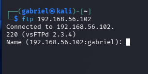

# 🛡️ Simulação de Ataques de Força Bruta com Kali Linux e Medusa

Este repositório documenta a realização do desafio prático da **DIO**, cujo objetivo é explorar conceitos de segurança ofensiva em ambiente controlado, simulando cenários de testes de intrusão (Pentest) para compreender vulnerabilidades de autenticação e suas respectivas formas de mitigação.

## 🛠️ 1. Configuração do Ambiente de Laboratório

Para a execução segura e controlada dos testes, o ambiente foi isolado utilizando o **Oracle VM VirtualBox** com duas máquinas virtuais conectadas através de uma rede interna (Host-Only):

* **Atacante (Attacker):** Kali Linux 
* **Alvo (Target):** Metasploitable 2 192.168.56.102
  * *O Metasploitable 2 já possui diversos serviços desatualizados e intencionalmente vulneráveis (como FTP,SMB e aplicações web como o DVWA).*

### Fase 1: Uso do Ping
primeiro pinguei metasploitable no kali linux se esta funcionado

## Configurando o Ambiente Virtual

Veja abaixo como realizar o teste de conexão:
aqui no inet 19.168.56.102 é o ip que vamos usar para o teste

Reconhecimento (Nmap)
Antes de iniciar os ataques, realizamos um escaneamento de portas para identificar quais serviços estavam ativos no alvo:
usando o comando para saber quais portas estão abertas 

## 🔍 2. Fases dos Testes e Execução
ftp primeiro vamos usar o comando ftp mais o ip 

aqui esta o ftp mas não conseguimos entra pois não sabemos ainda login para o acessalo

agora criaremos usuarios e senhas para ftp

agora com o usuarios e senhas criado vamos usar o medusa

aqui medusa esta verificando um brecha de login

agora voltamos para ftp
login com sucesso

DVWA:

AGORA vamos acessar dvwa abrar o navegador no kali digite este link

quando tentamos logar ele falha

aperta f12 no teclado vai abrir o inspecionar do navegador

quando tentamos acessar o inspecionar mostrar o que esta recebendo resposta 

agora no terminal vamos usar o medusa pra descobrir o usuario correto

descobrimos que usuário correto 

voltando no navegador conseguimos acessar o site 

SMB:
no terminal do kali vamos usar o comando enum4linux 

o programa rodando

agora vamos criar usuarios e senhas para smb

